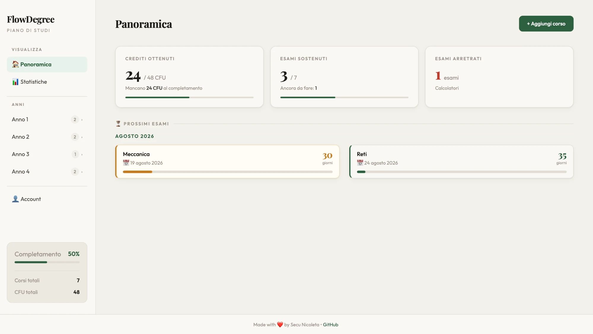
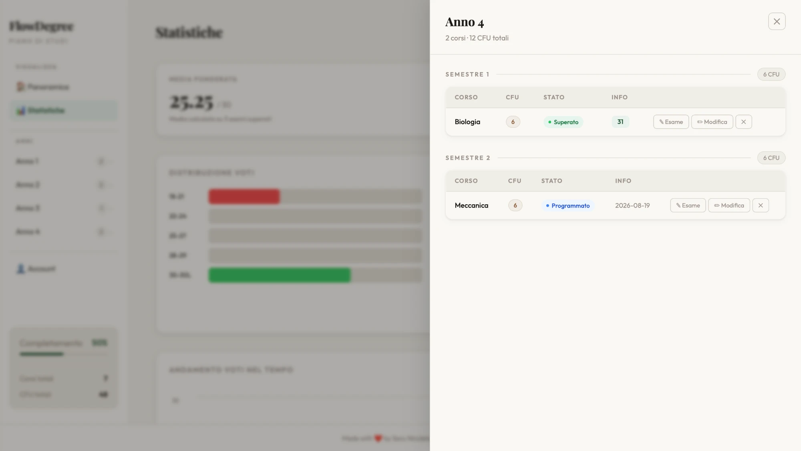
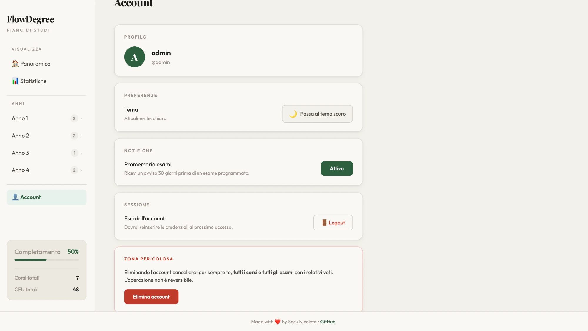

# FlowDegree

**Your university study plan, all in one place.**

FlowDegree is a full-stack web app to track courses, exams and progress through
your degree: earned credits, grade averages, statistics and a countdown to your
upcoming exams.

### Live app

**[flow-degree.vercel.app](https://flow-degree.vercel.app)**

You can sign up with a username and password, or log in with Google.

---

## Features

- **Courses and exams** — name, credits (CFU), year, semester and exam status
  (to take, scheduled, passed, overdue)
- **Statistics** — weighted and arithmetic average, grade distribution,
  credits per year and grade trend over time (with a gold medal on 30 cum laude)
- **Upcoming exams** — countdown with the remaining days, grouped by month
- **Smart duplicate detection** — recognises misspelled or already-added courses
  (e.g. `Analisi I` = `Analisi 1`) and suggests a correction
- **Multi-user** — each user only sees their own data (classic or Google login)
- **Light/dark theme** and a **responsive**, mobile-friendly design

---

## Screenshots



<p>
  
  
</p>

---

## Tech stack

| | |
|---|---|
| **Frontend** | React + Vite, deployed on Vercel |
| **Backend** | FastAPI (Python), deployed on Render |
| **Database** | PostgreSQL on Neon |
| **Auth** | JWT + Google OAuth 2.0, passwords hashed with Argon2 |

---

## Running locally

### Requirements
- Python 3.11+
- Node.js 18+

### Backend
```bash
python -m venv venv
./venv/bin/pip install -r requirements.txt
./venv/bin/uvicorn main:app --reload
```
With no environment variables it uses a local SQLite database (`flowdegree.db`),
so it runs out of the box with no setup. The API will be at `http://127.0.0.1:8000`.

### Frontend
```bash
cd frontend
npm install
npm run dev
```
The app will be at `http://localhost:5173`.

### Environment variables
Examples are in [`.env.example`](.env.example) (backend) and
[`frontend/.env.example`](frontend/.env.example) (frontend). In production they
are set on the respective dashboards (Render, Vercel, Neon).

---

## Project structure

```
FlowDegree/
├── main.py            # FastAPI API (auth, courses, exams endpoints)
├── models.py          # Database models (User, Course, Exam)
├── schemas.py         # Data validation (Pydantic)
├── auth.py            # JWT and password hashing
├── database.py        # Database connection
└── frontend/          # React app (Vite)
    └── src/
        ├── components/  # Login, Dashboard, Statistics, Account…
        ├── hooks/       # Course logic
        └── utils/       # API, helpers, duplicate detection
```

---

Made with care by [Nicoleta](https://github.com/NicoletaSecu)

---

© 2026 Nicoleta Secu — All rights reserved.
The code is public for viewing and as a portfolio reference. It may not be copied,
modified or redistributed without permission.
